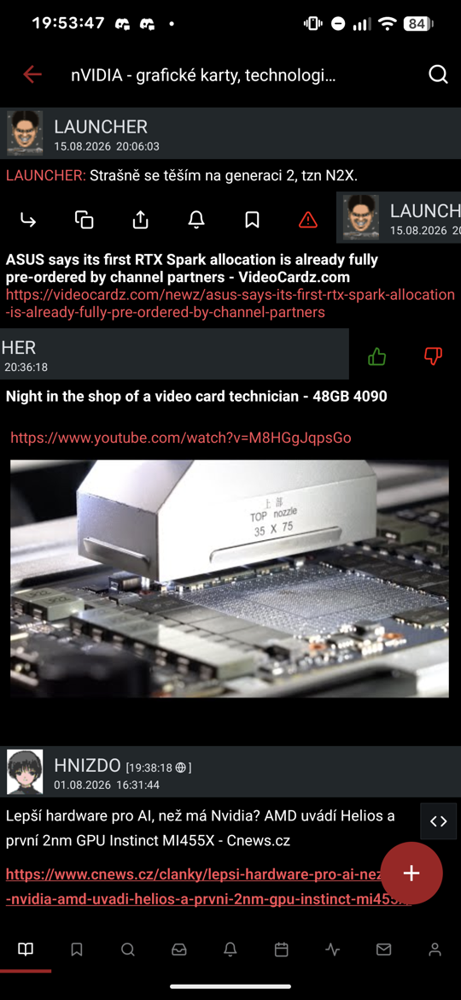
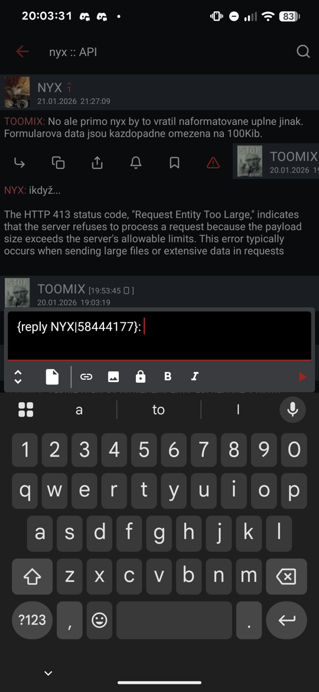
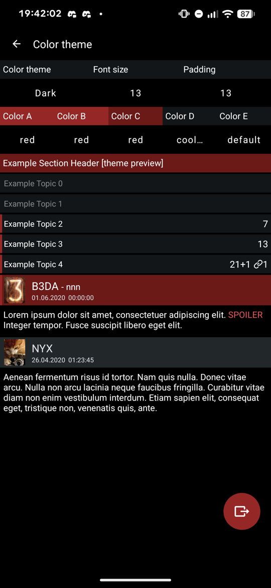

# NNN – neoficiální klient pro Nyx.cz

NNN je aplikace pro Android pro pohodlné používání [Nyx.cz](https://nyx.cz): diskuse, pošta, sledované kluby, upozornění a další funkce. Nabízí také čtení dříve načteného obsahu z offline cache a volitelného AI asistenta pro práci s diskusemi. K přihlášení potřebuješ účet na Nyxu.

**[Stáhnout na Google Play](https://play.google.com/store/apps/details?id=net.b3da.nnn)** · **[Podpora a zpětná vazba na Nyxu](https://nyx.cz/discussion/271373)**

Aplikace je neoficiální a není provozovaná službou Nyx.cz.

---

# NNN — Unofficial Nyx.cz client

Android client for the Czech discussion community [Nyx.cz](https://nyx.cz), built with **React Native and TypeScript**. Primarily developed and maintained by [Tomáš Beran](https://github.com/b3da-cz), with community contributions.

[Google Play](https://play.google.com/store/apps/details?id=net.b3da.nnn) · [Issues](https://github.com/b3da-cz/rn-nyx-app/issues) · [Privacy policy](https://docs.rnd.blue/nnn-privacy-policy.html)

## Screenshots

Discussion and post actions, the reply composer, and appearance settings with a live preview. Open an image for the larger view.

<p>
  <a href="docs/images/discussion.png"></a>
  <a href="docs/images/reply-composer.png"></a>
  <a href="docs/images/theme-preview.png"></a>
</p>

## Features

- **Discussions:** followed clubs, browsing history, unread filters, search, post ratings, polls and reminders.
- **Messages and notifications:** private conversations with attachments, push notifications, recent reactions and online friends.
- **Media and writing:** images, videos, YouTube previews, spoilers, Markdown and code blocks; persistent drafts and sharing into the app from Android.
- **Events:** browsing, a timeline, attendance responses and attendee lists.
- **Offline reading:** cached discussions, followed clubs, history, mail, reminders, events and notifications. Only previously loaded content is available; network actions still need a connection.
- **Personal preferences:** light and dark themes, custom colors, font sizes and spacing, image download limits, fingerprint lock and screenshot protection.

### Optional LLM assistant

Summarize or ask questions about selected discussion posts, choose a date range, reuse prompt templates and keep results in a local library. Requests send selected text to the chosen provider and require a connection.

The app supports Proton Lumo without an API key, OpenRouter with your API key, or a custom endpoint with an OpenAI-compatible API, a configured URL and an API key. Availability, usage limits and costs depend on the provider; these are remote services rather than on-device models.

## Technical highlights

- **Nyx API integration:** token authorization through [nyx-api](https://github.com/b3da-cz/nyx-api), extended with event endpoints in [NyxEventsApi.ts](src/lib/NyxEventsApi.ts).
- **Persistent cache:** per-discussion storage, bounded post/page retention and saved layout measurements; cached lists and feeds are reconciled with server responses. Storage uses MMKV with an AsyncStorage fallback.
- **Discussion rendering:** parsed post content, batched text measurements, image dimension handling and virtualized lists with precomputed layouts.
- **Android integration:** Kotlin modules for incoming shares, fingerprint authentication and screen protection; Firebase Cloud Messaging and maintained patches for older native dependencies.

The current stack is React Native 0.81, React 19, TypeScript, React Navigation 7 and React Native Paper, with Hermes and the Legacy Architecture on Android. See [package.json](package.json) and [patches/](patches/) for exact dependencies and compatibility fixes. The repository also contains an older iOS project; the setup below covers Android.

## Getting started

### Prerequisites

- Node.js **20.19.4 or newer** and npm; use the committed `package-lock.json`.
- JDK **17**, Android Studio, Android SDK Platform **36**, Build Tools **36.0.0** and NDK **27.1.12297006**, as configured in [android/build.gradle](android/build.gradle).
- An Android device or emulator running Android **7.0 / API 24** or newer, with Google Play services for FCM.

Follow the [React Native 0.81 environment setup](https://reactnative.dev/docs/0.81/set-up-your-environment) for SDK paths and device tooling; use this project's SDK versions above.

### Install and configure

```sh
npm ci
```

The `postinstall` script runs `patch-package` to apply the committed compatibility fixes. Use npm rather than Yarn.

Create `keys.json` in the repository root:

```json
{
  "bugfender": ""
}
```

A Bugfender key enables diagnostic logging and can remain empty for normal development;

Follow [Firebase's Android setup](https://firebase.google.com/docs/android/setup), register `net.b3da.nnn` and put the downloaded `google-services.json` in `android/app/`. The Google Services Gradle plugin requires this file; no placeholder is generated by the repository. Local Firebase configuration alone does not establish delivery from Nyx: FCM also depends on the server-side sender configuration.

Both configuration files are ignored by Git. Keep credentials and signing files out of commits.

### Run on Android

Start an emulator, or connect a device with USB debugging enabled and accept its authorization prompt. For a physical USB device:

```sh
adb reverse tcp:8081 tcp:8081
```

Start Metro, then run the Android app in a second terminal:

```sh
npm start
# In another terminal, from the repository root:
npm run android
```

Sign in with your existing Nyx account and confirm the app's authorization on Nyx when prompted.

## Android build and release

Configure release signing in your Gradle user properties, typically `~/.gradle/gradle.properties`, with `NNN_UPLOAD_STORE_FILE`, `NNN_UPLOAD_STORE_PASSWORD`, `NNN_UPLOAD_KEY_ALIAS` and `NNN_UPLOAD_KEY_PASSWORD`. The store path is resolved relative to `android/app/` unless absolute. The keystore and passwords are not included in the repository.

| Command               | Result                                                                       |
| --------------------- | ---------------------------------------------------------------------------- |
| `npm run release-apk` | Build and install a signed release APK on the connected device               |
| `npm run release-dev` | Build and install a signed release APK with the `.dev` application ID suffix |
| `npm run release-aab` | Build a Google Play bundle in `android/app/build/outputs/bundle/release/`    |

For the `.dev` variant, include a matching `net.b3da.nnn.dev` client in your Firebase configuration. App versions come from `package.json`: `version` becomes `versionName`, and `buildVersion` becomes `versionCode`. Increase `buildVersion` before uploading a new bundle to Google Play.

### Checks and maintenance

```sh
npm test -- --runInBand
npm run lint
```

- `vendor/react-native-notification-banner` is maintained locally, with a Kotlin implementation compatible with AGP 8 and Alerter 7.
- Keep `react-native-image-helper`: the notification banner loads it through reflection to render icons, even though there is no direct JavaScript import.
- The current dependency versions and patches support RN 0.81 and the Legacy Architecture. Check native module compatibility before upgrading; newer major versions may require the New Architecture.

## Contributing

Report bugs or propose changes through [GitHub issues](https://github.com/b3da-cz/rn-nyx-app/issues) and pull requests. Include the app version, Android version and steps to reproduce; remove private messages, tokens and other sensitive data from reports and screenshots. User support and feature discussion also happen in the [Nyx app club](https://nyx.cz/discussion/271373).

Thanks to the [contributors](https://github.com/b3da-cz/rn-nyx-app/graphs/contributors) who help maintain the app.

## Disclaimer and license

NNN is an unofficial client, independent of the operator of Nyx.cz. Accounts and community content are managed by Nyx.cz.

NNN is licensed under the [MIT License](LICENSE). Third-party components retain their own licenses.
